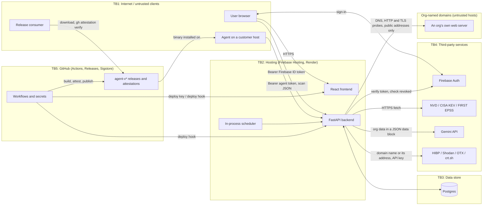

# Hacker Tracker threat model (STRIDE)

Written 2026-10-22 against commit `53f657f` on `main` (after #223 and the egress fix #224 merged). Owner: Arlo Kharod. Roadmap milestone S3.

This document lists the threats to Hacker Tracker by component. Each threat is classified as exactly one of the following:

| Class | Meaning | Evidence column holds |
|-------|---------|-----------------------|
| **CONTROL** | Code or configuration prevents or limits the threat. | `` `path::symbol` (Lnn) ``. The line number is the line at the time of writing and may drift; the symbol is what to search for. |
| **TEST** | A test that fails if the control is removed. | The pytest or Go test id. |
| **ACCEPTED** | The risk is known and accepted. | The reason, the owner and a review date. |
| **OPEN** | A known gap, scheduled for a later milestone. | The milestone and the roadmap item that closes it. |

**Rules used throughout**
- **Tests that run under the auth mock don't count as TEST.** `backend/tests/conftest.py` replaces Firebase token verification with a mock in every test, so an authentication or tenancy test proves the handler logic, not the boundary. Those rows are CONTROL, plus a shared OPEN row against S4's real-verification suite. Agent-token, AI and pure-function tests do not depend on the mock and can be TEST. Tests under `backend/tests/authz/` disable the mock and verify real, locally signed tokens through `firebase_admin.auth.verify_id_token(check_revoked=True)`, so they can be TEST.
- **Weaknesses are described at the level needed to plan the fix.** The repository is public.
- **CI enforces the format.** `.github/scripts/check_threat_model.py` checks every table on each PR (blocking once T-CI-05 is applied). See [Maintenance](#maintenance).

Area codes:

| Code | Area |
|------|------|
| `ENR` | agent enrollment |
| `UPL` | agent upload |
| `TOK` | agent tokens |
| `RPL` | replay |
| `AUTH` | human authentication |
| `TEN` | tenancy |
| `ING` | ingestion |
| `DOM` | domain checks (outbound probes) |
| `AI` | AI summary |
| `REL` | release supply chain |
| `CI` | CI and deploy |
| `PLAT` | platform-wide |

## System overview

Hacker Tracker is a vulnerability-intelligence web app for small organizations.
- Users sign in with Firebase Authentication and use a React frontend served from Firebase Hosting.
- The frontend calls a FastAPI backend on Render, which stores its data in Postgres.
- A read-only Linux agent, released from this repository's GitHub Actions, uploads a host's software inventory with a per-agent bearer token.
- The backend ingests public vulnerability feeds (NVD, CISA KEV, FIRST EPSS), matches them against each organization's inventory, and can ask the Gemini API for a plain-language summary.

## Trust boundaries

1. **TB1 → TB2: client to backend.** Every request is untrusted until authenticated, either with a Firebase ID token (humans) or an agent bearer token (agents).
2. **TB2 → TB3: backend to Postgres.** Tenancy is enforced in the backend, by each handler and repository. The database has no row-level security.
3. **TB2 → TB4: backend to third parties.** Feed content, model output and lookup results (HIBP, Shodan, OTX, crt.sh) are untrusted input to the backend. Org data sent to Gemini, and org domains sent to the lookup services, leave our control. The domain checks also probe a host the org names, so where the backend connects is itself attacker-influenced (DOM).
4. **TB5 → TB1/TB2: CI to production and to consumers.** Workflows hold deploy credentials and mint release attestations.
5. **Organization to organization, inside TB2/TB3.** This is a logical boundary: one org's members must not reach another org's data. Global admins cross it by design (T-TEN-08).

## Assets

- **Org data:** organization inventory, findings, assessments, uploads and vendor lists.
- **Agent tokens:** the raw token on the agent host, and its hash in the database.
- **Identities:** Firebase identities and the user↔org memberships and roles.
- **Release artifacts:** the agent binaries and the trust in their provenance.
- **Credentials:** the deploy credentials (Firebase service account, Render deploy hook) and the API keys (NVD, Gemini, HIBP, Shodan, OTX).
- **The backend's network position:** whatever the Render service can reach that the internet can't. The domain checks must not lend it out (DOM).
- **M365 integration secrets:** the stored Microsoft 365 OAuth tokens (encrypted at rest) and the `M365_FERNET_KEY` that encrypts them. The integration is disabled in production (T-PLAT-16).
- **Personal data:** the PII listed in [pii_inventory.md](pii_inventory.md), mainly email addresses and IP addresses in logs.

## Agent enrollment (ENR)

| ID | STRIDE | Threat | Class | Evidence | Notes |
|----|--------|--------|-------|----------|-------|
| T-ENR-01 | E | An org member who is not an admin enrolls a rogue agent for their org. | CONTROL | `backend/app/api/routes/v1/agents.py::enroll_agent` (L43) | Needs `require_org_role("admin")` and `get_current_org`. The route test `test_agent_routes.py::test_enroll_non_admin_forbidden` stubs the role check; see T-TEN-12. Kept apart from T-TEN-04 because an enrolled agent is a long-lived write credential, not a one-off admin action. |
| T-ENR-02 | I | A list or read endpoint returns an agent's secret or its hash after issuance. | TEST | `backend/tests/test_agent_token.py::test_agent_read_never_exposes_secret` | The raw token appears only in the enroll and rotate responses (`::test_token_issued_response_carries_raw_token_and_safe_agent`). |
| T-ENR-03 | E | An admin of org A rotates or revokes org B's agent by guessing its id. | CONTROL | `backend/app/repositories/agent_enrollments.py::get_by_id` (L62), `backend/app/api/routes/v1/agents.py::rotate_agent` (L95) | Lookup is by `(id, org_id)`; a cross-org id returns 404. Tested only with a stub repository (`test_agent_routes.py::test_rotate_unknown_or_cross_org_id_404`); see T-TEN-12. |
| T-ENR-04 | E | Rotation can extend or restore an older token's validity, and mints a fresh token from a revoked or expired enrollment. | OPEN | milestone: S4; item: revoked agent token (rotate only active rows; never move `revoked_at` later) | Admin-only, so it is a broken lifecycle rule, not an outside attack. |
| T-ENR-05 | R | Enroll, rotate and revoke leave no record of who did them. | CONTROL | `backend/app/api/routes/v1/agents.py::_audit_safe` (L148) | The audit write is best-effort: if it fails, the action still succeeds. |
| T-ENR-06 | E | Agent `scopes` are accepted at enrollment and stored, but never enforced, which suggests a restriction that doesn't exist. | ACCEPTED | reason: both agent routes are needed by every agent, so there is nothing to scope yet; documented here so the field isn't trusted; owner: Arlo; review: 2027-04-22 | Found while writing the model. Enforce or remove the field before adding a third agent route. |

## Agent upload (UPL)

| ID | STRIDE | Threat | Class | Evidence | Notes |
|----|--------|--------|-------|----------|-------|
| T-UPL-01 | S | An unauthenticated caller uploads a scan. | CONTROL | `backend/app/core/dependencies.py::get_agent_from_token` (L40) | The only agent-auth dependency. It returns a uniform 401. Route tests override it; the token logic itself is TEST in T-TOK-*. |
| T-UPL-02 | S | A human Firebase token is used on an agent route, or an agent token on a human route. | CONTROL | `backend/app/core/dependencies.py::get_agent_from_token` (L40), `backend/app/api/routes/v1/auth.py::get_current_user` (L32) | The two credential types have separate verifiers, so neither satisfies the other's routes. |
| T-UPL-03 | T | An agent writes into another org by naming it in the payload. | CONTROL | `backend/app/api/routes/v1/inventory.py::upload_agent_scan` (L439) | Every write uses `enrollment.org_id` from the token's database row; the payload has no org field. |
| T-UPL-04 | T | A payload with unexpected fields or an unknown shape is accepted. | TEST | `backend/tests/test_agent_scan_service.py::test_payload_rejects_unknown_fields`, `backend/tests/test_agent_scan_service.py::test_golden_fixture_validates_against_current_schema` | `AgentScanPayload` uses `extra="forbid"` and per-field length limits. |
| T-UPL-05 | T | An old or incompatible agent sends data the server misreads. | TEST | `backend/tests/test_agent_scan_service.py::test_scanner_version_below_min_rejected_426`, `backend/tests/test_agent_scan_service.py::test_assert_schema_supported_rejects_unknown` | Minimum scanner version 0.1.0, plus an explicit schema version. |
| T-UPL-06 | D | A very large request body exhausts backend memory before validation. | OPEN | milestone: S4; item: a body-size limit on the agent upload route | withdrawn: merged into T-PLAT-06, which covers the agent upload route along with the other JSON and file routes. |
| T-UPL-07 | D | A single agent floods the upload route. | CONTROL | `backend/app/core/limiter.py::agent_token_key` (L10) | 12/minute per token prefix. The limiter's storage and client identity need hardening (T-PLAT-05). |
| T-UPL-08 | R | An accepted scan has no matching audit row. | ACCEPTED | reason: the scan run row (`source = agent`) is committed in the same transaction as the import and is the primary record; the audit row is best-effort so an audit outage cannot drop scans; owner: Arlo; review: 2027-04-22 | |
| T-UPL-09 | I | The agent sends its bearer token over plain HTTP. | OPEN | milestone: S4; item: security headers (HSTS) and an HTTPS-only check on the agent's `--server` URL | The docs say "HTTPS only", but neither the agent nor the backend enforces it. Render terminates TLS. |

## Agent token lifecycle (TOK)

| ID | STRIDE | Threat | Class | Evidence | Notes |
|----|--------|--------|-------|----------|-------|
| T-TOK-01 | S | An attacker guesses a valid agent token. | CONTROL | `backend/app/services/agent_token.py::_generate_token` (L55) | 256-bit secret from `secrets.token_urlsafe(32)`, plus a public 8-hex prefix. |
| T-TOK-02 | I | A database dump yields usable agent tokens. | TEST | `backend/tests/test_agent_token.py::test_issue_returns_raw_token_once_and_stores_hash_only` | Only SHA-256 of the secret is stored. Unsalted is acceptable for a 256-bit random secret. |
| T-TOK-03 | S | Timing differences in the secret comparison leak the secret. | CONTROL | `backend/app/services/agent_token.py::verify` (L125) | `hmac.compare_digest` on equal-length hex digests. The unknown-prefix early return reveals only whether a prefix exists. |
| T-TOK-04 | S | A revoked token keeps working. | TEST | `backend/tests/test_agent_token.py::test_verify_rejects_revoked_token`, `backend/tests/test_agent_token.py::test_revoke_sets_revoked_at_to_now` | Tested against an in-memory repository. The route wiring is T-TOK-07. |
| T-TOK-05 | S | An expired token keeps working. | TEST | `backend/tests/test_agent_token.py::test_verify_rejects_expired_token`, `backend/tests/test_agent_token.py::test_issue_defaults_expiry_to_365_days` | |
| T-TOK-06 | S | After a rotation, the old token stays valid indefinitely. | CONTROL | `backend/app/services/agent_token.py::rotate` (L167) | Grace is 24h from the latest rotation of that row (`revoked_at = now + 24h`); see T-ENR-04. `test_agent_token.py::test_rotate_issues_new_token_and_grace_keeps_old_valid` covers the inside of the grace window only. |
| T-TOK-07 | S | The real token checks aren't wired into both agent routes as assumed. | OPEN | milestone: S4; item: revoked agent token and expired rotated token past its grace, tested end to end on both agent routes | The route tests override `get_agent_from_token`, and the service tests use a fake repository. |
| T-TOK-08 | E | Revoking a compromised agent by its old id after a rotation leaves the rotated successor valid. | OPEN | milestone: S4; item: revoked agent token (revocation covers the rotation chain, or the UI makes the successor obvious) | A rotation creates a new row with a new id. Found while writing the model. |
| T-TOK-09 | R | Failed agent authentication leaves no trace. | ACCEPTED | reason: with 256-bit secrets a guessing attack is infeasible, so logging every failure adds noise without a detection use; owner: Arlo; review: 2027-04-22 | Revisit if agent tokens move to a shorter secret. |

## Replay (RPL)

| ID | STRIDE | Threat | Class | Evidence | Notes |
|----|--------|--------|-------|----------|-------|
| T-RPL-01 | T | A captured upload is re-sent within the replay window to duplicate or reorder scan history. | TEST | `backend/tests/test_agent_scan_routes.py::test_upload_replay_fast_path_409`, `backend/tests/test_agent_scan_routes.py::test_upload_concurrent_replay_unique_violation_409` | A duplicate `(scan_id, nonce)` within 24 hours returns 409. A unique constraint catches the race. These tests override the token dependency, which this threat doesn't depend on. |
| T-RPL-02 | T | The `(scan_id, nonce)` pair is chosen by the client and isn't bound to a timestamp or a signature, so a request captured in transit could be replayed after the 24-hour window. | ACCEPTED | reason: replay only helps an attacker who captured a request but lacks the token, and TLS protects requests in transit (depends on T-UPL-09: HTTPS isn't enforced yet); anyone who holds the token can already mint fresh nonces, so a signed timestamp adds little over bearer-token secrecy for a read-only inventory feed; owner: Arlo; review: 2027-04-22 | Interview question S3-2. Revisit if uploads ever trigger actions. |
| T-RPL-03 | D | Nonce uniqueness is global, not per org, so one org's agent could occupy a pair another org later uses. | ACCEPTED | reason: the agent generates a random 16-byte nonce per attempt, so a collision would require predicting another org's nonce; owner: Arlo; review: 2027-04-22 | |
| T-RPL-04 | D | The nonce table grows without bound. | CONTROL | `backend/app/services/retention.py::_prune_scan_nonces` (L103) | A nightly sweep deletes nonces older than the replay window. |

## Human authentication (AUTH)

| ID | STRIDE | Threat | Class | Evidence | Notes |
|----|--------|--------|-------|----------|-------|
| T-AUTH-01 | S | A forged, expired or malformed Firebase ID token is accepted. | TEST | `backend/tests/authz/test_token_verification.py::test_forged_signature_rejected`, `backend/tests/authz/test_token_verification.py::test_expired_token_rejected`, `backend/tests/authz/test_token_verification.py::test_hs256_token_rejected`, `backend/tests/authz/test_token_verification.py::test_structurally_invalid_claims_rejected`, `backend/tests/authz/test_account_linking.py::test_token_without_email_claim_rejected` | real-verification: locally signed tokens through the real SDK path (see T-AUTH-07). Forged, expired, algorithm-confused (HS256 keyed on the served certificate), kid missing or unknown, bad `sub` and future-dated `iat` tokens, and a token with no email claim, all return 401 and create no account. Control: `auth.py::get_current_user` (`verify_id_token`, 10-second clock skew, fail-closed). |
| T-AUTH-02 | S | A revoked session or a disabled account keeps working. | TEST | `backend/tests/authz/test_token_verification.py::test_revoked_token_rejected`, `backend/tests/authz/test_token_verification.py::test_disabled_user_rejected`, `backend/tests/authz/test_account_linking.py::test_inactive_local_user_rejected` | real-verification: `check_revoked=True` against a fake Identity Toolkit at the HTTP layer; a revoked token and a disabled Firebase user return 401, and an inactive local user returns 403. Control: `auth.py::get_current_user`. |
| T-AUTH-03 | S | **Email-link fallback**: a sign-in with an unverified email is linked to an existing account that has the same email, taking it over. | TEST | `backend/tests/authz/test_account_linking.py::test_unverified_email_does_not_link_existing_account`, `backend/tests/authz/test_account_linking.py::test_verified_email_links_existing_unbound_account`, `backend/tests/authz/test_account_linking.py::test_account_bound_to_another_uid_is_not_relinked` | real-verification: real signed tokens against a seeded local user. An unverified email gets 403 and the account stays unbound; a verified email on an unbound account links it (200); an account already bound to another uid is refused (403) and keeps its uid. Control: `auth.py::get_current_user` (L69), added in S0. There is no passwordless email-link sign-in in the product; "email-link fallback" means this account-linking path. |
| T-AUTH-04 | S | First sign-in and invite acceptance don't yet require a verified email. | OPEN | milestone: S4; item: real token verification (require `email_verified` for auto-create and for invite acceptance) | Accepting an invite also requires the invite token. Found while writing the model. |
| T-AUTH-05 | D | A Firebase outage makes every authenticated request fail. | ACCEPTED | reason: fail-closed is the intended behaviour for a revocation check; owner: Arlo; review: 2027-04-22 | |
| T-AUTH-06 | R | Failed sign-ins leave no trace. | CONTROL | `backend/app/api/routes/v1/auth.py::get_current_user` (L45) | Logs a warning (`test_auth.py::test_me_invalid_token_logs_warning`). The account-link refusal logs the user id, not the email. |
| T-AUTH-07 | S | Every AUTH control above has only been tested with a mocked token verifier. | TEST | `backend/tests/authz/test_token_verification.py::test_forged_signature_rejected` | real-verification: locally signed RS256 key served at the SDK's cert URL; check_revoked=True against a fake Identity Toolkit at the HTTP layer; the guard test fails if the mock returns. Guard: `test_harness.py::test_verify_id_token_is_real`. Other key tests in `test_token_verification.py`: expired, wrong audience, wrong issuer, HS256 keyed on the served certificate (algorithm confusion), alg none, kid missing or unknown, empty or over-long `sub`, `iat` beyond the clock skew, revoked, disabled, unknown account, and an agent token on a Firebase route and a Firebase token on the agent routes, each rejected with 401. The account-linking and local-account gates are in `test_account_linking.py` (see T-AUTH-01 to T-AUTH-03). The autouse mock stays in `backend/tests/conftest.py` for all other tests; the other AUTH and TEN rows move in later stages. |

## Organization tenancy and the global-admin boundary (TEN)

| ID | STRIDE | Threat | Class | Evidence | Notes |
|----|--------|--------|-------|----------|-------|
| T-TEN-01 | I | A member of org B reads org A's data by changing `org_id` in the path. | CONTROL | `backend/app/core/dependencies.py::check_org_access` (L165) | Used by 31 handlers (path or query `org_id`) for domains, uploads, vendors, inventory and M365. The tests of those routes patch it out. |
| T-TEN-02 | I | An object id from another org is used on an org-scoped route (IDOR). | CONTROL | `backend/app/repositories/assets.py::SqlAssetRepository.get_by_id` (L33) | Repositories take `org_id` and filter by it on get, update and delete. Only a repository-level test exists (`test_assets.py::test_asset_repo_get_by_id_scopes_by_org`). The exception is `assessment_submission`, whose route checks the org first (T-TEN-11). |
| T-TEN-03 | I | A `/mine/...` route returns another org's data. | CONTROL | `backend/app/core/dependencies.py::get_current_org` (L108) | The org comes from the caller's user row and is never taken from the request. Global admins don't bypass this check. |
| T-TEN-04 | E | An org member performs admin-only actions: agent management, invites, member roles, debug, and the AI summary history. | CONTROL | `backend/app/core/dependencies.py::require_org_role` (L137), `backend/app/core/dependencies.py::require_membership_role` (L248) | Tests stub the dependencies (`test_membership_api.py::test_update_member_role_requires_org_admin`). |
| T-TEN-05 | E | An org member (not an admin) deletes org data or disconnects an integration on routes that only check membership. | OPEN | milestone: S4; item: member vs admin on admin-only routes (add org-role checks to destructive `check_org_access` routes) | Affects several destructive org-scoped routes. Found while writing the model. |
| T-TEN-06 | E | An org admin makes themselves or someone else the owner. | CONTROL | `backend/app/api/routes/v1/members.py::update_member_role` (L266), `backend/app/api/routes/v1/members.py::create_invite` (L46) | Both refuse `owner`. Owner is creator-only (onboarding), and the last owner can't be demoted or removed. |
| T-TEN-07 | E | Any org admin can invite or promote other admins, although the code's docstring says that is owner-only. | OPEN | milestone: S4; item: member vs admin on admin-only routes (decide owner-only admin grants and enforce it) | It is a design decision, not a bypass, but the code and its comment disagree. |
| T-TEN-08 | E | A global admin reads, writes, exports or deletes any organization. | ACCEPTED | reason: global admin is the operator role, provisioned only by a direct database change (no API grants it), and cross-org support access is a product requirement; export and delete are audited; owner: Arlo; review: 2027-04-22 | Wider than the README said (it said "read"); the README is corrected. Interview question S3-3. |
| T-TEN-09 | E | A user escalates to global admin through the API. | CONTROL | `backend/app/api/routes/v1/auth.py::get_current_user` (L96), `backend/app/api/routes/v1/onboarding.py::complete_onboarding` (L70) | New users start as `viewer`. The only role write in code is viewer → member at onboarding. |
| T-TEN-10 | T | The analytics event route doesn't bind events to the caller's org. | OPEN | milestone: S4; item: route-enumerating suite (cross-tenant writes) | Write-only: nothing is disclosed. |
| T-TEN-11 | I | Assessment submissions are fetched by id without an org filter in the repository. | CONTROL | `backend/app/api/routes/v1/assessments.py::_ensure_org_access` (L26) | The route loads the object and then checks its `organization_id`. This is safe today but fragile; a new caller that skips the check would be an IDOR. |
| T-TEN-12 | I | Tenancy is enforced by convention in each handler; no test runs the real tenancy dependencies, and the two role stores (legacy `users.org_id`/`org_role` and `Membership`) can disagree. | OPEN | milestone: S4; item: route-enumerating authorization suite with cross-tenant tests under real token verification | The S4 suite is the fix. `require_org_or_admin` is unused dead code and is not credited here. |
| T-TEN-13 | T | A user sets protected organization fields, such as the demo flag, at creation by mass assignment. | CONTROL | `backend/app/schemas/organization.py::OrganizationCreate` (L17) | The create schema has no `is_demo` or role fields. |

## Ingestion: NVD, CISA KEV, FIRST EPSS (ING)

| ID | STRIDE | Threat | Class | Evidence | Notes |
|----|--------|--------|-------|----------|-------|
| T-ING-01 | T | A network attacker alters feed responses in transit. | CONTROL | `backend/app/ingestors/nvd.py::ingest_nvd` (L369) | HTTPS endpoints with httpx's default TLS verification; no `verify=False` in the feed ingestors. The domain probe skips certificate checks on purpose, because it reports on the certificate (T-DOM-06). |
| T-ING-02 | T | A compromised or poisoned upstream feed publishes false CVE, KEV or EPSS data. | ACCEPTED | reason: NIST, CISA and FIRST are the authoritative sources and publish no signed feeds; records are shape-validated but their content is trusted as published; owner: Arlo; review: 2027-04-22 | NVD updates overwrite the stored description and score on every pass. |
| T-ING-03 | T | Malformed feed records are stored. | TEST | `backend/tests/test_validators.py::TestNvdCveValidationSchema::test_invalid_cve_id`, `backend/tests/test_validators.py::TestCisaKevValidationSchema::test_invalid_cve_id`, `backend/tests/test_epss_ingest.py::test_ingest_epss_skips_malformed_scores` | CVSS is clamped to [0, 10]; severity is checked against an allow-list. |
| T-ING-04 | T | EPSS values outside [0, 1], or for CVEs that weren't requested, are stored. | OPEN | milestone: S5; item: manual AppSec findings (input validation on ingestion) | |
| T-ING-05 | D | A bad or partial feed wipes the stored vulnerability data. | CONTROL | `backend/app/ingestors/nvd.py::upsert_normalized_cve` (L65), `backend/app/ingestors/cisa_kev.py::ingest_cisa_kev` (L93) | Ingestion only inserts and updates; it never deletes. KEV commits once per run. NVD commits per page, so a failure mid-run leaves a partial update. |
| T-ING-06 | D | A slow or oversized feed response ties up a worker or exhausts memory. | OPEN | milestone: S5; item: manual AppSec findings (explicit timeouts and response-size caps on feed fetches) | The KEV client has no explicit timeout; all three fetchers read the full body. |
| T-ING-07 | T | A failed or partial sync is reported as completed, so data freshness looks green. | OPEN | milestone: S5; item: manual AppSec findings (EPSS batch errors and NVD 429s mark the run partial) | |
| T-ING-08 | E | A non-admin triggers, retries or cancels ingestion runs. | CONTROL | `backend/app/api/routes/v1/ingest.py::trigger_ingestion` (L613) | Requires the global admin role. The trigger tests call the function directly, bypassing the role check; see T-TEN-12. |
| T-ING-09 | D | Concurrent runs of the same source corrupt data or double the load. | TEST | `backend/tests/test_ingest_run_behaviors.py::test_run_ingestion_skips_when_lock_held`, `backend/tests/test_ingest_lock.py::test_acquire_lock_contention` | A Postgres advisory lock per source. |
| T-ING-10 | I | The NVD API key is sent in a URL query string on two enrichment paths and can end up in error logs. | OPEN | milestone: S5; item: manual AppSec findings (send the NVD key as a header on every path) | The main ingestors already send it as a header. Exposure is limited to people who can read the operator's logs. Shodan's API requires its key as a query parameter, so the same logging care applies there. Found while writing the model. |
| T-ING-11 | I | The public `/api/v1/ingest/health` endpoint reveals per-source staleness and failure counts. | ACCEPTED | reason: intended for external uptime monitors; it shows no tenant data; owner: Arlo; review: 2027-04-22 | |

## Domain checks: outbound probes (DOM)

The external checks probe a domain the org itself names (its primary domain, or a domain on its list), and query lookup services about it. Any org member can trigger them (`check_org_access` on the domain route), and the findings engine runs them on the org's primary domain. So the destination of these requests is attacker-influenced. #224 added the guards below before this model was published.

| ID | STRIDE | Threat | Class | Evidence | Notes |
|----|--------|--------|-------|----------|-------|
| T-DOM-01 | E | A domain that resolves to a private, loopback, link-local or other non-public address makes the backend's HTTP, TLS or fingerprint probe reach a service only the backend can reach (SSRF). | TEST | `backend/tests/test_domain_checks_egress.py::test_http_check_makes_no_request_to_an_internal_host`, `backend/tests/test_domain_checks_egress.py::test_ssl_check_opens_no_socket_to_an_internal_host`, `backend/tests/test_domain_checks_egress.py::test_tech_fingerprint_makes_no_request_to_an_internal_host`, `backend/tests/test_domain_checks_egress.py::test_is_public_ip_rejects_internal_addresses`, `backend/tests/test_domain_checks_egress.py::test_resolve_public_ip_refuses_when_any_address_is_internal`, `backend/tests/test_domain_checks_egress.py::test_normalize_hostname_rejects_non_hostnames`, `backend/tests/test_domain_checks_egress.py::test_tier1_with_an_invalid_hostname_touches_nothing` | `domain_checks.py::resolve_public_ip` refuses unless every resolved address is globally routable (IPv4-mapped and translation ranges included); `::normalize_hostname` rejects IP literals and non-hostnames. The tests fake only DNS and the transport, not the guard. Found while writing the model; fixed in #224. |
| T-DOM-02 | E | A public host redirects the probe to an internal host, an IP literal or a non-default port. | CONTROL | `backend/app/services/domain_checks.py::_http_client` (L124), `backend/app/services/domain_checks.py::_fetch_public_hops` (L146) | The client is built with `follow_redirects=False`; `_fetch_public_hops` follows redirects itself, re-checks every hop and refuses non-default ports, up to 5 hops. CONTROL rather than TEST: the egress tests replace `_http_client`, so they would still pass if the client followed redirects itself, which would skip the per-hop check. No test covers the port rule either. That regression risk is T-DOM-09. The hop checks are tested by `test_domain_checks_egress.py::test_http_check_does_not_follow_a_redirect_to_an_internal_host`, `::test_http_check_does_not_follow_a_redirect_to_an_ip_literal` and `::test_http_check_stops_after_the_redirect_limit`; `::test_each_redirect_hop_uses_a_fresh_connection` checks that each hop gets its own client. |
| T-DOM-03 | E | DNS rebinding: the name resolves to a public address for the check and to an internal one for the connection. | TEST | `backend/tests/test_domain_checks_egress.py::test_http_check_connects_to_the_checked_address`, `backend/tests/test_domain_checks_egress.py::test_ssl_check_connects_to_the_checked_address` | The probe connects to the address that was checked and sends the hostname as `Host` and SNI, so there is no second lookup. |
| T-DOM-04 | D | A slow or very large response from the probed host ties up a worker or exhausts memory. | CONTROL | `backend/app/services/domain_checks.py::_fetch_public` (L141), `backend/app/services/domain_checks.py::_fetch_public_hops` (L146) | The HTTP and fingerprint probes ask for an uncompressed body, stop after the chunk that reaches 256 KB, and run under an overall fetch deadline; the TLS probe has a 5-second timeout per socket operation. CONTROL rather than TEST because no test proves the read stops at the cap (T-DOM-08): `test_domain_checks_egress.py::test_fetched_body_is_capped` checks only the stored text. The deadline is tested by `::test_slow_host_is_cut_off_by_the_deadline`. |
| T-DOM-05 | I | A lookup service (Shodan) is queried about, and reports on, an internal address the domain resolves to. | TEST | `backend/tests/test_domain_checks_egress.py::test_shodan_does_not_report_or_query_an_internal_address` | |
| T-DOM-06 | T | The HTTP and fingerprint probes skip TLS certificate verification, and the TLS probe retries without verification to inspect an invalid certificate, so an on-path attacker could alter what they report. | ACCEPTED | reason: the checks report on the target's own headers and certificate, including invalid ones, so verification would hide the very thing being measured; results are informational and are not used for any security decision; owner: Arlo; review: 2027-04-22 | The CodeQL alert for this call (`py/request-without-cert-validation`) was dismissed as won't-fix on 2026-10-22. The feed ingestors do verify (T-ING-01). |
| T-DOM-07 | I | Org domains, and the addresses they resolve to, are sent to third-party lookup services (HIBP, Shodan, OTX, crt.sh). | ACCEPTED | reason: these lookups are the feature; only the domain name or its public address is sent, with no user identifiers; each keyed source is skipped when its key isn't configured; owner: Arlo; review: 2027-04-22 | Like T-AI-10, the data leaves our control once sent. |
| T-DOM-08 | D | Gaps left after #224: only the first resolved address is tried, `primary_domain` isn't validated when it is written, a server that ignores the identity encoding gets a header-only fingerprint, and the header check reads a body it doesn't use. No test proves the body read stops at the cap (T-DOM-04). | OPEN | milestone: S5; item: manual AppSec findings (domain-check follow-ups from #224) | Availability, defence in depth and test coverage. The regression tests for the redirect guards are T-DOM-09. |
| T-DOM-09 | E | A later change makes the HTTP client follow redirects itself, or drops the default-port rule, and no test notices, which reopens T-DOM-02. | OPEN | milestone: S4; item: egress guard regression tests (pin the real client's `follow_redirects=False`; test a redirect to a non-default port) | The guards are in place today (T-DOM-02); what's missing is a test that fails if they are removed. |

## AI summary inputs and output (AI)

This section builds on the S5a case study, [docs/ai/case-study.md](../ai/case-study.md#threat-model-and-blast-radius). The model has no tools and no network access, so the realistic harm is a misleading briefing.

| ID | STRIDE | Threat | Class | Evidence | Notes |
|----|--------|--------|-------|----------|-------|
| T-AI-01 | T | Org-supplied text (a name, a vendor, a domain) injects instructions into the prompt. | TEST | `backend/tests/test_ai_summary_injection.py::test_attack_reaches_the_prompt_only_inside_the_data_block`, `backend/tests/test_ai_summary_hardening.py::test_hostile_org_value_appears_only_inside_the_data_block` | All org fields go into one JSON data block that the prompt labels untrusted. |
| T-AI-02 | T | Org data forges the end-of-data marker and escapes the block. | TEST | `backend/tests/test_ai_summary_hardening.py::test_unicode_line_breaks_cannot_forge_the_end_line` | |
| T-AI-03 | T | The model obeys an injected instruction, and its output is served. | TEST | `backend/tests/test_ai_summary_injection.py::test_attack_compliant_output_never_serves_the_canary` | A model that complies with the attack still never gets the canary into the response or the stored row. |
| T-AI-04 | T | Invented or uncited risks are shown to users as findings. | TEST | `backend/tests/test_ai_summary_hardening.py::test_grounding_drops_a_risk_citing_an_unknown_id`, `backend/tests/test_ai_summary_hardening.py::test_grounding_drops_an_uncited_risk` | Grounding keeps only risks that cite findings shown in the prompt. |
| T-AI-05 | T | Malformed or truncated model output is served raw. | TEST | `backend/tests/test_ai_summary_hardening.py::test_unparseable_output_serves_the_template_not_the_raw_text`, `backend/tests/test_ai_summary_hardening.py::test_truncated_output_serves_the_template` | A deterministic template is served instead. |
| T-AI-06 | T | A schema-valid, grounded but misleading briefing gets through. | ACCEPTED | reason: model behaviour can't be proven; the S5a held-out run had 0 of 10 attacks succeed, readers see the cited findings next to the text, and the model has no tools; owner: Arlo; review: 2027-04-22 | |
| T-AI-07 | T | Model output carries script into the browser (XSS). | CONTROL | `frontend/src/components/tabs/AISummaryTab.tsx::AISummaryTab` (L314) | Rendered as plain JSX text with no markdown renderer. There is no `dangerouslySetInnerHTML` anywhere in `frontend/src`. |
| T-AI-08 | I | One org's summary or generation history is served to another org. | CONTROL | `backend/app/repositories/ai_summary_generation.py::SqlAISummaryGenerationRepository.get` (L42) | Filters by `(id, org_id)`. `test_ai_summary_generation.py::test_repository_get_returns_none_for_wrong_org` runs against a mocked session, so it can't catch a missing filter. The route takes the org from the caller (`organizations.py::get_ai_summary`); the HTTP path is part of T-TEN-12. |
| T-AI-09 | D | Repeated forced refreshes run up Gemini spend. | OPEN | milestone: S5; item: manual AppSec findings (per-user or per-org quota on `force_refresh`) | 5/minute per IP, per process; any org member can force a refresh. |
| T-AI-10 | I | Org data sent to Gemini leaves our control. | ACCEPTED | reason: documented in pii_inventory.md; only org-level fields and findings are sent, no user identifiers; owner: Arlo; review: 2027-04-22 | |
| T-AI-11 | I | The Gemini API key is exposed. | CONTROL | `backend/app/core/config.py::GEMINI_API_KEY` (L109) | Read from the environment (`sync: false` on Render) and passed only to the SDK client. |

## Agent release supply chain (REL)

| ID | STRIDE | Threat | Class | Evidence | Notes |
|----|--------|--------|-------|----------|-------|
| T-REL-01 | S | A binary not built by this workflow passes as an official release. | CONTROL | `.github/workflows/agent-release.yml::jobs.verify` (L266) | Keyless build-provenance and SBOM attestations, checked with `gh attestation verify` pinned to this repository, the signing workflow, the source ref and GitHub-hosted runners. A tamper self-test confirms a modified binary fails. |
| T-REL-02 | T | An `agent-v*` tag is moved, or created on an unreviewed commit, and that commit is released. | OPEN | milestone: OWNER; item: tag ruleset for `agent-v*` | `--source-ref` pins a ref name, not a commit, and the commit-digest check runs only when the runner's `gh` supports it. Confirmed unapplied 2026-10-22. |
| T-REL-03 | T | Assets are swapped between verification and publication, or after publication, by someone with release-write access. | OPEN | milestone: OWNER; item: immutable releases | `SHA256SUMS` and the SBOM files aren't attested as files. Consumers who verify the binary still catch a swapped binary. Confirmed unapplied 2026-10-22. |
| T-REL-04 | E | A compromised third-party action or tool in the build job abuses its `id-token: write` to sign a malicious binary. | CONTROL | `.github/workflows/agent-release.yml::jobs.build.permissions` (L35), `.github/workflows/security.yml::jobs.scan-exceptions` (L16) | Only the build job can mint attestations; publish and verify hold no `id-token`. Every `uses:` must be a 40-hex SHA (enforced in CI, blocking once T-CI-05 is applied); `go install` tools are pinned to versions, checked against the Go checksum database. |
| T-REL-05 | T | The Go toolchain (`check-latest`) and the runner's `gh` float between releases. | ACCEPTED | reason: both come from the GitHub-hosted runner image and the official Go distribution, which are already trust roots of the attestation; pinning them adds upkeep without changing who we trust; owner: Arlo; review: 2027-04-22 | |
| T-REL-06 | T | The SBOM doesn't describe the shipped binary. | TEST | `.github/scripts/test_check_sbom.py::CheckSbomTests::test_wrong_go_version_fails`, `.github/scripts/test_check_sbom.py::CheckSbomTests::test_devel_main_version_fails` | The SBOM is generated from the built binary, and `check_sbom.py` runs in the release job. |
| T-REL-07 | E | A release ships a binary with a known-vulnerable dependency or standard library. | CONTROL | `.github/workflows/agent-release.yml::jobs.build.steps` (L126) | Binary-mode `govulncheck` blocks the release. |
| T-REL-08 | S | A consumer runs a downloaded binary without verifying it. | ACCEPTED | reason: verification can't be forced on a consumer; `docs/security/agent_release_verification.md` gives the exact commands, and `SHA256SUMS` alone is documented as detecting corruption only; owner: Arlo; review: 2027-04-22 | |

## CI and deploy secrets (CI)

| ID | STRIDE | Threat | Class | Evidence | Notes |
|----|--------|--------|-------|----------|-------|
| T-CI-01 | E | A pull request from a fork exfiltrates the deploy secrets. | CONTROL | `.github/workflows/ci.yml::jobs.deploy-preview.if` (L186) | The preview deploy runs only for same-repository branches. No workflow uses `pull_request_target` or `workflow_run`. |
| T-CI-02 | E | A same-repository branch, which needs write access, reads the Firebase deploy credential in the preview job, which runs third-party build code. | OPEN | milestone: OWNER; item: GitHub Environment with required reviewers for deploy secrets, and keyless deploy (the S1 Firebase follow-ups) | No environment gate today. |
| T-CI-03 | T | A workflow uses a mutable action tag that is later repointed. | CONTROL | `.github/workflows/security.yml::jobs.scan-exceptions` (L16) | The pin check fails CI on any `uses:` that isn't a 40-hex SHA (blocking once T-CI-05 is applied). |
| T-CI-04 | I | Checkouts leave `GITHUB_TOKEN` in the git config while third-party build code runs. | OPEN | milestone: OWNER; item: `persist-credentials: false` on the remaining checkouts | Missing in `ci.yml`, `matcher-regression.yml` and `secret-scan.yml`. Most of those tokens are `contents: read`. |
| T-CI-05 | T | Code reaches `main` without the security gates passing or without review. | OPEN | milestone: OWNER; item: required checks and code-scanning rule on `main`, and Dependabot security updates | The `main` ruleset is applied (no deletion, no force-push, a PR required, five required checks). It doesn't require the Security, CodeQL or Secret scan jobs, requires 0 approvals, and admins can bypass it. Dependabot security updates are off. Checked 2026-10-22. |
| T-CI-06 | I | The Render deploy hook URL leaks or is triggered from an untrusted context. | CONTROL | `.github/workflows/ci.yml::jobs.deploy-backend` (L308) | Used only on pushes to `main`, through an environment variable; it is never echoed. |
| T-CI-07 | I | A secret is committed to the repository. | CONTROL | `.github/workflows/secret-scan.yml::gitleaks` (L16) | Gitleaks scans the full history on every PR, and GitHub push protection is on. |
| T-CI-08 | T | A vulnerable dependency ships in the backend, the frontend or the image. | CONTROL | `.github/workflows/security.yml::jobs.pip-audit` (L74), `.github/workflows/security.yml::jobs.trivy` (L135) | pip-audit with hash-pinned lockfiles, npm audit, govulncheck and Trivy, all failing the job (blocking once T-CI-05 is applied). |

## Platform-wide (PLAT)

| ID | STRIDE | Threat | Class | Evidence | Notes |
|----|--------|--------|-------|----------|-------|
| T-PLAT-01 | T | Clickjacking, MIME sniffing and missing transport security, because no security headers are sent by the API or by Firebase Hosting. | OPEN | milestone: S4; item: security headers middleware and a `headers` block in `firebase.json` | No CSP, HSTS, X-Frame-Options or nosniff anywhere. |
| T-PLAT-02 | S | A page on another origin calls the API with a user's credentials. | TEST | `backend/tests/test_cors_guard.py::test_cors_localhost_blocked_in_production` | The CORS allowlist comes from settings, and production refuses `localhost` origins. The API uses bearer tokens, not cookies, which also limits CSRF. |
| T-PLAT-03 | E | A missing `APP_ENV` silently relaxes the production guards (CORS, `SECRET_KEY`), or a loose origin passes the CORS guard. | OPEN | milestone: S5; item: manual AppSec findings (fail closed when `APP_ENV` is unset; reject wildcard, IP and `http://` origins in production) | `APP_ENV` defaults to `development`. |
| T-PLAT-04 | S | Production runs with the default `SECRET_KEY`. | TEST | `backend/tests/test_secret_key_guard.py::test_default_secret_key_blocks_production` | Render generates the value. |
| T-PLAT-05 | D | Rate-limit storage and client identity need hardening (shared store, trusted client identity, limits on data-lifecycle routes). | OPEN | milestone: S5; item: manual AppSec findings (proxy-aware client IP, shared limiter store, limits on data-lifecycle routes) | Limits key on client or proxy IPs (unverified). |
| T-PLAT-06 | D | Large request bodies exhaust backend memory before validation, on the agent upload route and on the other JSON and file routes. | OPEN | milestone: S4; item: a body-size limit on the agent upload route (applied app-wide, with a pre-read check on file uploads) | Per-list caps don't bound request size; no request-size limit is enforced yet. Absorbs T-UPL-06. |
| T-PLAT-07 | I | Error responses and stored error fields leak internal exception text, such as database errors to the agent status route or SDK errors to the AI history. | OPEN | milestone: S5; item: manual AppSec findings (error-message policy and a global exception handler) | Unhandled errors already return a generic 500 body. |
| T-PLAT-08 | I | `/docs` and `/openapi.json` are public in production. | ACCEPTED | reason: the source and routes are public in this repository, and the schema reveals nothing the code doesn't; owner: Arlo; review: 2027-04-22 | |
| T-PLAT-09 | D | `/health` is static, so the platform reports healthy while the database is down. | OPEN | milestone: S4; item: a `/health` that checks the database | Render's health check uses `/health`. |
| T-PLAT-10 | I | Personal data reaches stdout logs: an email address on one member route, client or proxy IPs (unverified) in the access logs, and no scrubber outside Sentry. | OPEN | milestone: S5; item: manual AppSec findings (log scrubbing and access-log policy) | `pii_inventory.md` and `privacy.md` are corrected to match the code. Found while writing the model. |
| T-PLAT-11 | I | The Firebase service-account file written at startup is readable by other users of the container. | ACCEPTED | reason: the container runs a single non-root process with no other users; owner: Arlo; review: 2027-04-22 | Revisit if the image gains other processes. |
| T-PLAT-12 | T | SQL injection through query parameters. | CONTROL | `.github/workflows/codeql.yml::jobs.analyze` (L15) | CodeQL (`security-extended`) scans the Python code on every PR to `main` (blocking once T-CI-05 is applied). The ORM is used throughout. The few `text()` queries, such as the one in `data_lifecycle.py::export_organization`, build identifiers from hard-coded allowlists and bind every value. |
| T-PLAT-13 | T | A client-supplied `X-Request-ID` injects forged lines into the logs. | OPEN | milestone: S5; item: manual AppSec findings (validate the request-id characters) | Capped at 128 characters, but the characters aren't checked. |
| T-PLAT-14 | R | An organization's deletion or export can't be attributed to the person who did it. | TEST | `backend/tests/test_data_lifecycle.py::test_delete_org_purges_tenant_rows_and_audits`, `backend/tests/test_data_lifecycle.py::test_export_org_streams_json_and_audits` | Each writes an audit row. Delete writes it in the same transaction. |
| T-PLAT-15 | I | Error reports sent to Sentry carry personal data or secrets. | CONTROL | `backend/app/core/observability.py::_before_send` (L73) | `send_default_pii=False`, plus redaction of sensitive keys and email addresses. |
| T-PLAT-16 | E | The Microsoft 365 OAuth integration (consent, callback, stored tokens and device sync) isn't modelled. | ACCEPTED | reason: disabled in production (`ENABLE_M365_INTEGRATION` is off, and the consent, callback, sync and disconnect routes refuse requests), so it is not reachable; it must be modelled before the flag is enabled; owner: Arlo; review: 2027-04-22 | See the Maintenance triggers. |

## Findings

These are what writing the model surfaced that wasn't already known or documented. One was serious and was fixed before publication (finding 1). None of the others was judged severe: none is an exploitable cross-tenant read, an authentication bypass or a leaked credential. Apart from finding 1, none is fixed in S3; each is scheduled.

1. **The domain checks could be pointed at internal addresses (SSRF).** Found while writing the model, and fixed in #224 before publication: T-DOM-01 to T-DOM-05. Follow-ups are T-DOM-08 (S5) and T-DOM-09 (S4).
2. **Several destructive org-scoped routes check only membership**, not an org role: T-TEN-05.
3. **First sign-in and invite acceptance don't yet require a verified email**: T-AUTH-04. S0 closed the account-takeover path; this is the remaining gap.
4. **Revocation doesn't follow a rotation** (T-TOK-08), and **rotation can extend or restore an older token's validity** (T-ENR-04).
5. **The NVD API key travels in a URL query string** on two paths: T-ING-10.
6. **The analytics event route doesn't bind events to the caller's org**: T-TEN-10. Write-only.
7. **Docs and code disagreed** in several places, and the docs are corrected in this PR:
   - the README's upload-size, rate-limit and global-admin claims;
   - `pii_inventory.md` (an email is logged; there's no stdout scrubber; the retention rules);
   - `privacy.md` (the request logs, the hosting region, who can export or delete);
   - `agent_enrollment.md` ("HTTPS only", the scan-history cap).
8. **Agent scopes are stored but not enforced** (T-ENR-06), and a tenancy helper, `require_org_or_admin`, is dead code. Neither is credited as a control.
9. **Rate-limit storage and client identity need hardening**: T-PLAT-05.
10. **The Microsoft 365 integration isn't modelled**, because it is disabled in production: T-PLAT-16.

## OPEN RISK index

| Milestone | Rows |
|-----------|------|
| S4 (authorization assurance) | T-PLAT-06, T-ENR-04, T-UPL-09, T-TOK-07, T-TOK-08, T-AUTH-04, T-TEN-05, T-TEN-07, T-TEN-10, T-TEN-12, T-DOM-09, T-PLAT-01, T-PLAT-09 |
| S5 (DAST and manual AppSec) | T-ING-04, T-ING-06, T-ING-07, T-ING-10, T-DOM-08, T-AI-09, T-PLAT-03, T-PLAT-05, T-PLAT-07, T-PLAT-10, T-PLAT-13 |
| OWNER (repo hardening, Arlo) | T-REL-02, T-REL-03, T-CI-02, T-CI-04, T-CI-05 |

## ACCEPTED RISK register

Every accepted risk is owned by Arlo and is due for review on **2027-04-22**. CI fails once that date passes until each row is re-reviewed (blocking once T-CI-05 is applied):
- T-ENR-06, T-UPL-08, T-TOK-09;
- T-RPL-02, T-RPL-03;
- T-AUTH-05, T-TEN-08;
- T-ING-02, T-ING-11;
- T-DOM-06, T-DOM-07;
- T-AI-06, T-AI-10;
- T-REL-05, T-REL-08;
- T-PLAT-08, T-PLAT-11, T-PLAT-16.

The reasons are in each row.

## Out of scope

The following are out of scope:
- the developer's workstation;
- the internal security of GitHub, Google (Firebase and Gemini), Render, the NVD, CISA and FIRST services, and the HIBP, Shodan, OTX and crt.sh lookup services;
- physical access;
- the Go agent's local collectors, which are read-only and open no listener (roadmap R6).

## Maintenance

**When to update.** Update this document when you:
- add a route or a dependency on an external service;
- change a trust boundary, or the auth or tenancy code;
- enable a feature flag that exposes a route (for example `ENABLE_M365_INTEGRATION`, T-PLAT-16);
- close an OPEN row: change it to CONTROL or TEST with the new evidence.

**IDs.** IDs are stable and never renumbered. A threat that no longer applies keeps its row, with Notes starting `withdrawn: <reason>`.

**What CI checks.** `.github/scripts/check_threat_model.py` runs in the `Scan exceptions and workflow pins` job of `security.yml` and checks that:
- every row has exactly one valid class;
- every CONTROL path and symbol exists;
- every TEST names a test that exists;
- every OPEN row names S4, S5, S6 or OWNER;
- every ACCEPTED row has an owner and an unexpired review date.

An expired review date fails every PR until the row is reviewed. This is deliberate, and matches how `scan_exceptions.md` handles expiry. The Security workflow isn't a required check yet, so these failures are blocking only once T-CI-05 is applied.

**What CI doesn't check.** The checks are syntactic. Whether a cited symbol actually implements the control, and whether a TEST would fail if the control were removed, are checked only in review. The auth-mock guard is keyed on the area code (AUTH, TEN) alone, and a CONTROL symbol matches as a whole word anywhere in the cited file.
